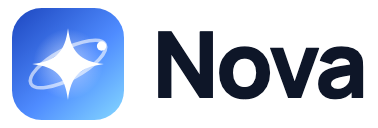
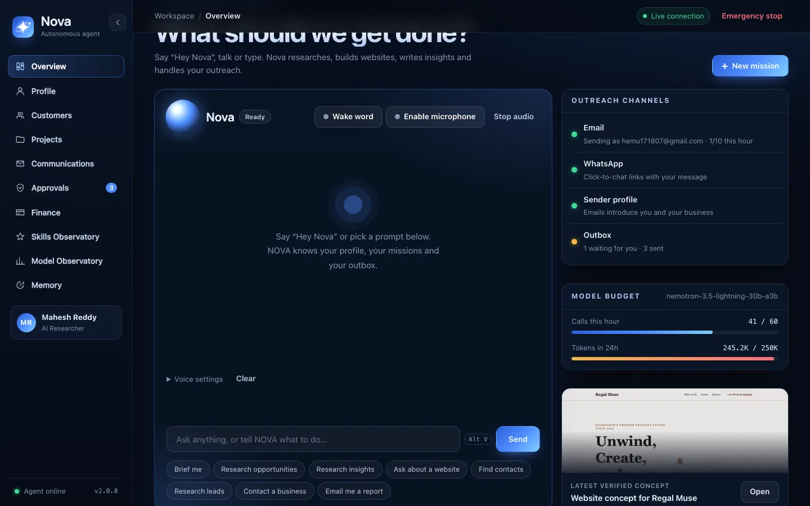
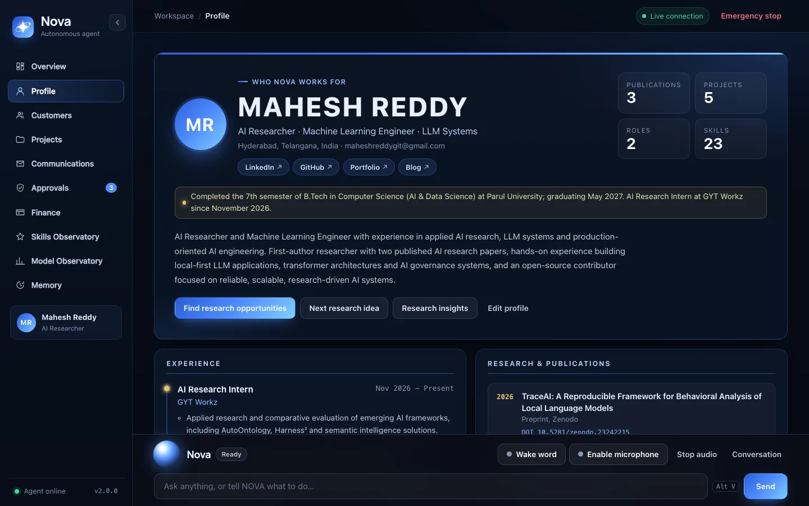
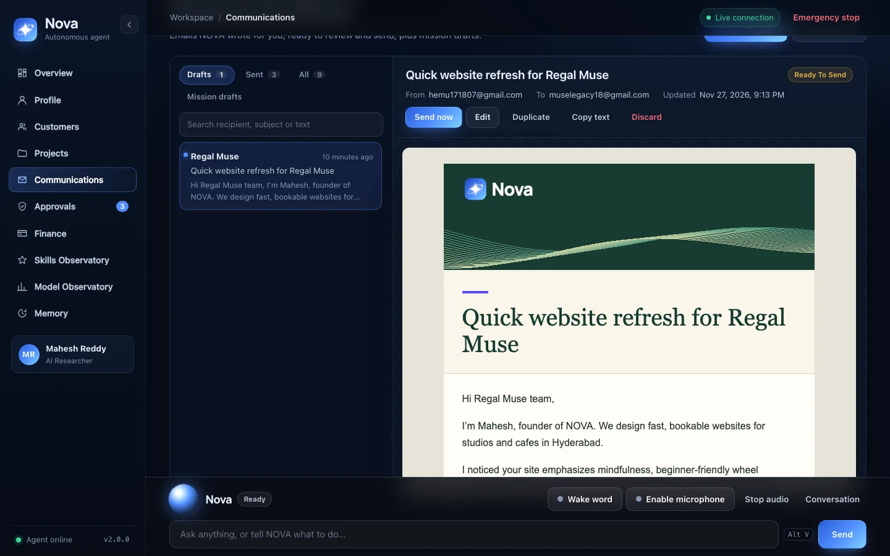
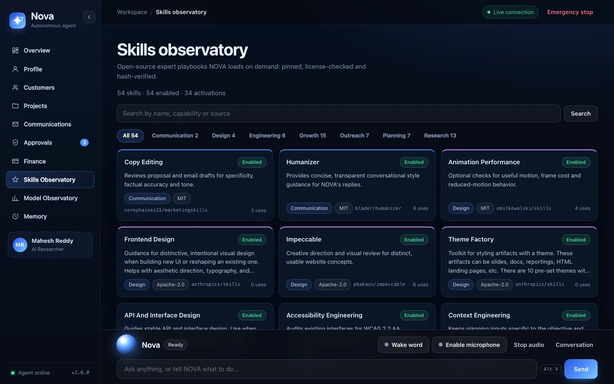
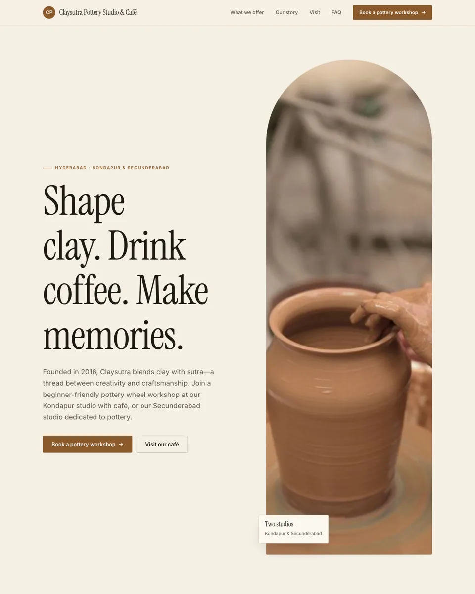
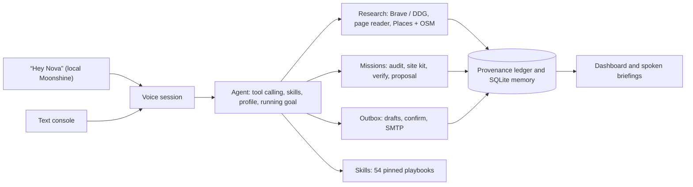

<div align="center">

<picture>
  <source media="(prefers-color-scheme: dark)" srcset="docs/images/nova-lockup-light.png">
  
</picture>

### Your personal AI agent for research, websites and outreach

Say **“Hey Nova”**. Nova researches with real sources, builds website concepts that can win a pitch, writes and sends email for you, and briefs you on everything that happened while you were away.

[](LICENSE)


[Quick start](#quick-start) · [What Nova does](#what-nova-does) · [Talk to Nova](#talk-to-nova) · [Configuration](#configuration) · [Architecture](#architecture) · [License](#license)

<br>



</div>

---

## What Nova does

| | |
| --- | --- |
| **Voice-first agent** | An offline **“Hey Nova”** wake word. On wake, Nova speaks a briefing of what changed since you last checked in. It's a tool-calling agent on NVIDIA Nemotron, with the composed style of a chief of staff. |
| **Research with receipts** | `deep_research` searches the web, reads the pages and answers from what it read. Every fetch is logged with its HTTP status and a content hash. Answers that name a site Nova didn't fetch are flagged. |
| **Finds your next clients** | Ranks local businesses by rating weighted by review count. It flags those with **no website** or only a social page, and finds their published contact details. |
| **Websites that pitch themselves** | Nova plans the copy and art direction. A hand-crafted design system renders it with the business's own photos and bundled fonts. Chromium and a vision critic score two themes, and the better one wins. |
| **Outreach that sends** | Drafts personal emails and sends them through your Gmail **only after you say “send it”**. It never guesses an address. Emails carry a branded HTML design, and WhatsApp click-to-chat links are prepared for you. |
| **Knows who it works for** | Your profile (role, publications, projects, goals) shapes every suggestion, and Nova introduces you properly to professors, labs and clients. |
| **54 expert skills** | Open-source playbooks, loaded on demand, for literature review, scientific writing, cold email, SEO, CRO, pricing, design, planning and more. |
| **Calls you for review** | `voice_bridge`, a free WebRTC voice call any agent can use. Your phone rings through ntfy, you talk it through, and your instructions go back to the agent. |

<table>
<tr>
<td width="50%"><br><sub><b>Profile</b>: a living CV that steers the agent</sub></td>
<td width="50%"><br><sub><b>Communications</b>: an outbox with the real email design</sub></td>
</tr>
<tr>
<td width="50%"><br><sub><b>Skills observatory</b>: 54 pinned, license-checked playbooks</sub></td>
<td width="50%"><br><sub><b>Website concept</b>: generated from a real business's site and photos</sub></td>
</tr>
</table>

## Quick start

```sh
uv python install 3.12
uv sync --locked --python 3.12
uv run playwright install chromium        # used to verify website concepts
cp .env.example .env                      # then add your keys (see Configuration)
uv run nova serve                         # open http://127.0.0.1:8000
```

Click **Wake word**, allow the microphone once and say **“Hey Nova”**. Or just type in the console.

Useful checks:
- `uv run nova check-nvidia` tests model access.
- `uv run nova check-email --send-test` confirms Gmail sending.

## Talk to Nova

| Say or type | What happens |
| --- | --- |
| “Hey Nova” | A chime, then a spoken briefing: finished missions, concept scores, emails sent, leads, approvals and anything waiting on you. |
| “Find cafés in Gachibowli without a website, best rated first” | A ranked list with ratings, review counts, website status and phone numbers. |
| “Build a website concept for the top one” | Audit → design kit → two themes scored → verified concept and proposal in about 90 s. |
| “Email them about a redesign” | Finds a verified address and drafts a personal email. Say **“send it”** to send. |
| “Find research internships abroad that fit my profile” | Sourced options, with the websites it read listed under the answer. |
| “Write a literature review outline on LLM evaluation” | Loads the literature-review skill and follows its method. |
| “Email me a summary of today” | Sends a report to your own inbox. |
| “That's all” | Back to standby. |

Follow-ups keep their context. “Now filter those by reviews and pick the top five” builds on the previous step instead of starting over.

## How it works

### Website concepts
1. Nova audits the public page, reads the business's own copy and collects its photographs.
2. The site model writes a **plan**: theme, accent, headline, offerings, story, process, FAQ and calls to action. Copywriting, Frontend Design and Theme Factory skills guide it.
3. The **site kit** renders the plan in one of four art-directed themes: Editorial, Modern, Noir and Fresh. It uses semantic, accessible components and bundled OFL fonts, with no external requests.
4. Chromium renders the chosen theme and a contrasting alternative at 1440, 820 and 390 px. axe-core and layout probes check the technical quality, and the NVIDIA vision model critiques the design. A revision pass uses that critique, and the best variant wins.

### Verified tool use
Every network call made inside a tool is recorded in the `tool_calls` ledger: URL, HTTP status, bytes, provider and a SHA-256 prefix. Each answer shows **“✓ N tool calls · M sources fetched”** with the evidence underneath. If an answer names a website no tool returned in that turn, Nova adds a visible note.

### Model routing
Each job uses the model that measured best for it (`uv run python tools/model_bench.py` re-runs the benchmark on your key; results appear in **Model Observatory**):

| Job | Model | Measured |
| --- | --- | --- |
| Conversation and tool calling | Nemotron 3.5 Super 120B | 4/4 correct tool choices · 0.8 s per call · 0.3 s to first word |
| Small talk | Nemotron 3.5 Bolt | 0.2 s to first word |
| Planning briefs | Nemotron 3 Ultra 550B, with Super fallback | Most concrete plans; 30–120 s in the background |
| Website plans | Nemotron 3.5 Super 120B | Design 74.6 in 6 s (Ultra: 76.0 in 77 s, within critic noise) |
| Design critique | Nemotron 3 Nano Omni | Reads screenshots |

On this key, Kimi K3.1 Pro and GLM-5.3 Flash timed out, while Mistral Large 4, MiniMax M3.1 and Step-5 answered correctly but took 7–32 s per call. They are too slow for voice, but `tools/model_bench.py` will show if that changes.

## Configuration

Copy `.env.example` to `.env`. Everything has a sensible default except your keys.

| Setting | Purpose |
| --- | --- |
| `NVIDIA_API_KEY` | Models, voice recognition and speech ([NVIDIA Build](https://build.nvidia.com/)) |
| `DEEPGRAM_API_KEY`, `DEEPGRAM_VOICE`, `TTS_PROVIDER` | Nova's speaking voice through [Deepgram Aura-2](https://developers.deepgram.com/docs/tts-models) (default `aura-2-athena-en`). Without a key, Nova speaks with NVIDIA Magpie |
| `EMAIL_HOST`, `EMAIL_USER`, `EMAIL_PASS`, `ADMIN_EMAILS` | Sending email. For Gmail, use an [app password](https://myaccount.google.com/apppasswords) |
| `OWNER_NAME`, `BUSINESS_NAME`, `BUSINESS_ABOUT`, `BUSINESS_WEBSITE` | How Nova introduces you in outreach and signatures |
| `BRAVE_SEARCH_API_KEY` | Reliable web search (free tier). Without it, Nova falls back to DuckDuckGo, which can rate-limit |
| `GOOGLE_PLACES_API_KEY` | Google ratings, review counts and website status for local businesses |
| `WAKE_WORD`, `WAKE_THRESHOLD`, `OWNER_ADDRESS`, `PERSONA` | Wake phrase, its sensitivity, how Nova addresses you, and its personality |
| `AGENT_MODEL`, `PLANNER_MODEL`, `SITE_MODEL`, `FAST_MODEL` | Model routing |
| `SITE_BUILDER` | `kit` (default), `model` or `template` |
| `MAX_CALLS_HOUR`, `MAX_DAILY_TOKENS`, `MAX_EMAILS_HOUR` | Budgets and safety limits |

Your profile lives in `memory/profile.json` (edit it on the **Profile** page). All personal data stays on your Mac, under `memory/` and `workspace/`, both gitignored.

## Architecture



| Path | What it holds |
| --- | --- |
| `nova/agent.py` | Tool-calling agent, prompt sections, parallel tools, verification |
| `nova/conversation.py`, `nova/wake.py`, `nova/briefing.py` | Voice session, wake word, spoken briefings |
| `nova/research.py`, `nova/places.py`, `nova/provenance.py` | Search, page reading, local businesses, evidence ledger |
| `nova/sitekit/` | Design system, themes, fonts and the plan → render → critique pipeline |
| `nova/outreach.py` | Outbox, email design, delivery |
| `nova/skills/` | Skill registry, lock file and the reviewed library |
| `tools/` | Skill packager and model benchmark |
| `voice_bridge/` | Standalone `call_user_for_review` voice-call tool |

## Privacy and safety

- The wake word is detected on your Mac; audio is sent for transcription only after you say “Hey Nova”.
- Business email is sent only after you confirm it, and addresses must come from a source or from you. Sending is capped per hour, and **Emergency stop** halts everything.
- Phone numbers and email addresses from your profile are never put into model prompts.
- Skills are text-only. Nova never runs their scripts or grants them tools.

## Development

```sh
uv run pytest -q                                  # 110 tests
uv run python tools/model_bench.py                # benchmark models on Nova's real jobs
uv run python tools/package_skills.py --help      # add or recompile skills
```

## License

Nova is released under the [MIT License](LICENSE). © 2026 Mahesh Reddy.

Bundled skills, fonts and libraries keep their own licenses; see [THIRD_PARTY_NOTICES.md](THIRD_PARTY_NOTICES.md). Note that openWakeWord's pretrained models, used only if you choose `WAKE_WORD=hey_jarvis` or a similar model, are non-commercial (CC BY-NC-SA 4.0). The default “Hey Nova” uses MIT-licensed Moonshine.

**Name and logo.** The MIT license covers the code, not the Nova name or the Nova logo. Please don't use them to brand a fork or derived product. “Nova” is a common word, so run a trademark search in your target markets before commercial launch.
